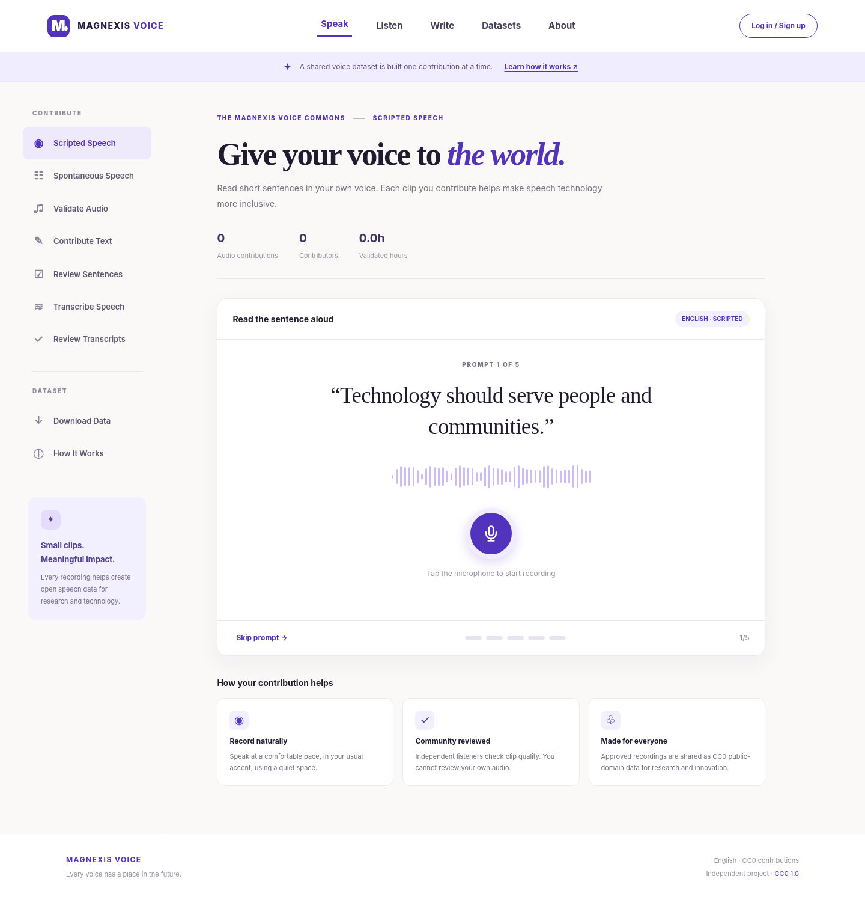
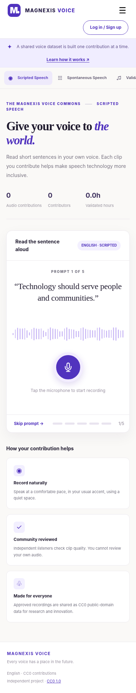

# Magnexis Voice v1.25 — Electron desktop

The Electron wrapper loads the same web backend as the browser. Node integration is disabled, context isolation and Chromium sandbox are enabled, and microphone permissions are scoped to the configured trusted origin.

## Run locally

Install Node.js 22+, run `npm install`, start `node server.mjs` in one terminal and then run `npm run desktop`.

## Hosted backend

The packaged Windows client defaults to `https://magnexis-voice-commons.netlify.app`. Set `MAGNEXIS_VOICE_URL` to override that target for development or another verified HTTPS deployment. Server-side authentication, recordings and moderation still require live deployment testing.

## Build Windows installer

Run `npm run desktop:build` on Windows or manually invoke the **Build Windows Desktop** GitHub Actions workflow. The generated NSIS installer is unsigned unless separately signed; it has not yet been published as a verified release. Electron's wrapper is real source code, not a tested downloadable executable.

## Screenshots

These are local browser UI smoke-test screenshots with simulated API responses, not Electron package screenshots.
